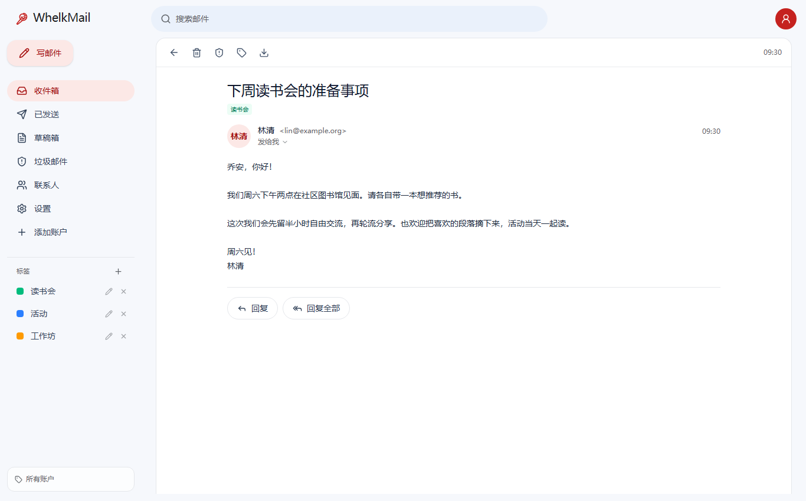
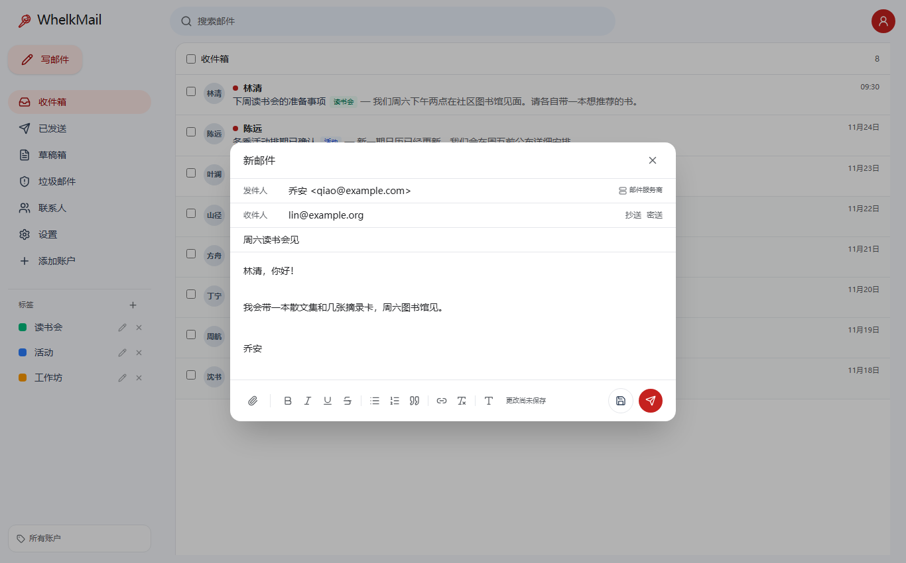
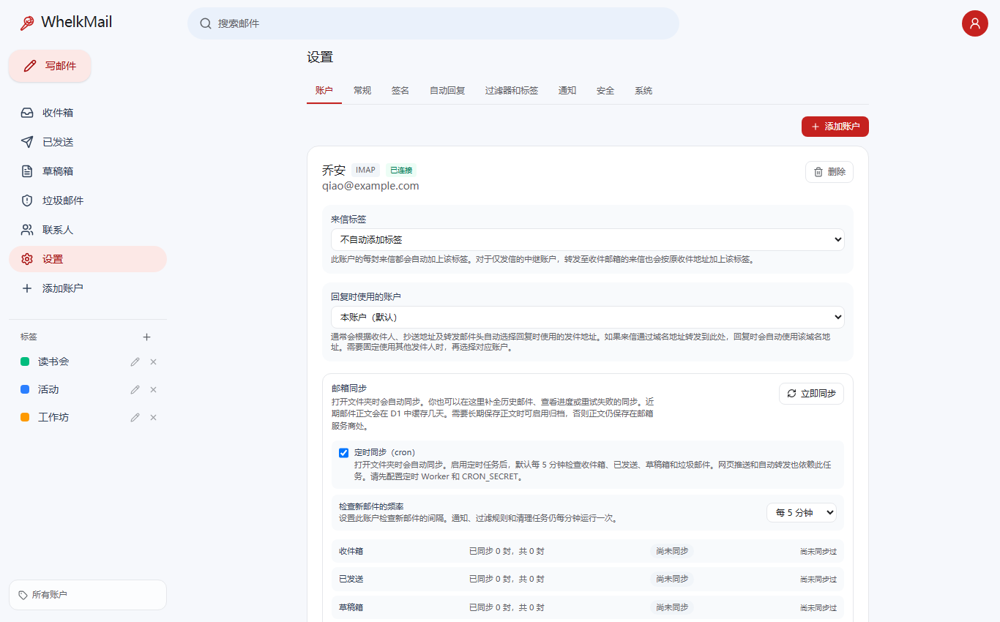

# WhelkMail

**Your mailboxes. Your domain. One calm inbox.**

[](LICENSE)
[](https://workers.cloudflare.com)
[](https://pages.cloudflare.com)
[](#using-this-repository)

[](https://deploy.workers.cloudflare.com/?url=https://github.com/WhelkMail/WhelkMail)

WhelkMail is a self-hosted webmail client for the IMAP and SMTP accounts you already own. One repository deploys to **Cloudflare Workers** (default), **Cloudflare Pages** (for existing installations) or **Docker on any VPS**, so there is no mail server to operate and no infrastructure to babysit.

Connect Gmail, Outlook, iCloud, Fastmail, Yahoo or a custom domain and get a familiar, Gmail-style interface on top of the mailboxes you already use. Messages, sent copies, drafts and attachments stay on your provider; only a short-lived D1 cache and the strictly opt-in long-term archive copy them.

> **WhelkMail is not a mail server.** It talks IMAP and SMTP to the providers you already trust.

**Try it:** [demo.whelkmail.eu](https://demo.whelkmail.eu) is a live public demo of the app. **Install it:** the [WhelkMail Installer](https://github.com/WhelkMail/installer) (beta) provisions and deploys a WhelkMail instance inside your own Cloudflare account, from the browser or the terminal.

[Quick start](#quick-start) · [Installer](#installer-beta) · [Deploy on Cloudflare](#deploy-on-cloudflare) · [Deploy on Docker](#deploy-on-docker) · [Security](#security) · [Documentation](#documentation)

## Screenshots


| Reading a message | Composing |
| --- | --- |
|  |  |

| Account settings | Connect an address |
| --- | --- |
|  |  |

## Why WhelkMail

- **One inbox, many accounts.** Gmail, Outlook, iCloud, Yahoo and custom domains side by side, with colored account labels and a shared address book.
- **Cloudflare-first, not Cloudflare-only.** Workers with D1, R2 and `cloudflare:sockets` by default; the same code runs on Pages or in a single Docker container with SQLite and any S3-compatible bucket.
- **Your data stays put.** By default the client reads from the provider. A short-lived D1 cache keeps recently listed or opened bodies for fast opens; the long-term archive on R2 or Google Drive remains strictly opt-in.
- **Privacy by default.** HTML email is rendered in a sandboxed frame, remote images and tracking pixels stay blocked unless you enable them for a message, and credentials are encrypted at rest.
- **Actually yours.** Self-hosted, MIT licensed, no telemetry, no vendor account required beyond your Cloudflare project.

## What you get

### Inbox experience

- Message list with a full-width reading view or an optional right-side reading pane, plus Gmail-style multi-select for delete, move and spam actions.
- Inbox, Sent, Drafts and Spam with autosave and reopenable drafts.
- Gmail-style conversations (RFC `References` when available, subject fallback otherwise): one list row per thread showing the senders and the message count (`Mario, Luca +2  5`), and a reading pane that stacks every message of the thread (your replies included) as a one-line header you can click to expand. Threads are per account and every standard view is grouped: inbox, sent, spam, label views and search results. Drafts are the exception: each draft is listed on its own.
- HTML bodies in a sandboxed frame with optional remote images; attachment indicators from `BODYSTRUCTURE` without downloading the body up front.
- Rich text composer with bold, lists, links and quotes; the default rich/plain format is saved per device, so desktop and phone can differ. Drafts keep their HTML.
- Installable PWA, mobile drawer layout and Web Push notifications with per-account/folder preferences.
- English by default, Italian available; the dictionary is extensible.

### Accounts and sending

- Multiple accounts in one view, each with its own IMAP/SMTP servers and credentials.
- Password, app-password, Google OAuth2 and Microsoft OAuth2 (XOAUTH2) authentication.
- Sending through each account's own SMTP server.
- **Replies from the right address**: when a domain only forwards to a provider mailbox (`EMAIL@DOMAIN.IT` → `EMAIL@PROVIDER.IT`), a reply leaves from the domain account automatically — the app matches the message's To/Cc and forwarding headers (`Delivered-To`, `X-Original-To`, `Envelope-To`, `Received … for`) against its accounts. Settings → Accounts → **Reply as** forces a different sender for a mailbox. A relay account with **Send from any address on this domain** answers as the address the message was actually sent to, with no account per address.
- Send-only "relay" accounts (SMTP2GO, Resend, Mailgun, Brevo, SendGrid, Mailjet, Postmark, Cloudflare Email Service or a custom SMTP server with manual host/port/credentials) for domains without SMTP. Sent copies and drafts go to Google Drive, Cloudflare R2, or the Sent/Drafts folders of an IMAP account you already read — pick one destination per account. A relay on your own domain can also reply from **any address on that domain** (`Send from any address on this domain`), so a forwarding domain needs one account, not one per address. Cloudflare Email Service is **experimental**: see [Limitations](#limitations).
- Optional archive and provider cleanup for IMAP: archive bodies and attachments, then move the original to the provider Trash.

### Organization

- Gmail-style labels shared across all accounts, with a label view that collects messages from Inbox, Sent, Drafts and Spam.
- Per-account incoming labels applied automatically.
- Contacts with search, edit, CSV import/export and recipient autocomplete in To/Cc/Bcc. Each contact has first/last name, email, phone, company, job title, address, website, birthday, additional emails/phones and notes. **vCard import auto-detects 3.0/4.0**, export defaults to vCard 3.0 with optional 4.0, and CSV stays available. Recipients of sent messages are added to **Other contacts** for autocomplete (on by default; Settings → General switches to manual only). Typing an unknown address offers **Add … to contacts** in the autocomplete menu, and replying to an unknown sender adds it silently. Contacts live in D1, so they do not need R2 or Drive.
- Signatures: one shared signature or a different signature per account, with rich-text formatting.
- Vacation responder (auto-reply): one shared message for all accounts or a different one per account, with rich-text body.

### Automation

- Gmail-style filters shared across accounts: match From/To/Subject/words/attachments and apply labels and/or forward the original EML.
- Incremental, resumable IMAP metadata sync into D1, with per-account status and automatic resume.
- Optional background sync through the cron worker: each IMAP account chooses its own interval (1, 2, 5, 10, 15 or 30 minutes, 5 by default).
- Vacation responder runs from the same cron worker; it replies at most once per sender every 24 hours and marks the reply as automatic.
- Anti-loop forwarding headers, per-filter forward logs and deletion logs.

## Security

- Single deployment password plus optional **TOTP two-factor authentication** (RFC 6238) from Settings → Security, disabled by default and compatible with any authenticator app. Recovery codes are shown once and stored hashed.
- Random server-side sessions stored as SHA-256 hashes in D1, 7-day TTL, real revocation on logout.
- Login and 2FA rate limiting per IP.
- AES-256-GCM encryption for IMAP/SMTP passwords, OAuth refresh tokens and relay keys; HKDF-derived keys for session and challenge signatures.
- One-time OAuth state stored in D1 plus PKCE (`S256`) for Google, Microsoft and Drive.
- CSP, HSTS, `nosniff`, `X-Frame-Options`, `Referrer-Policy` and `Permissions-Policy` on static assets and API responses.
- HTML bodies rendered in a sandboxed iframe with a restrictive CSP; scripts and forms are blocked and remote images are opt-in per message.

See [docs/DOCUMENTATION.md](docs/DOCUMENTATION.md) for the full threat model and [docs/CLOUDFLARE.md](docs/CLOUDFLARE.md) for the deployment checklist.

## Stack

- React 19 + Vite 8 + TypeScript + Tailwind CSS
- One runtime-agnostic API core (`server/`) with three thin entrypoints
- Cloudflare Workers (default) or Pages Functions, sharing D1 and R2
- Docker / Node 24 entrypoint with built-in SQLite (`node:sqlite`)
- `cloudflare:sockets` on Cloudflare, `node:net`/`node:tls` on Node, for IMAP/SMTP
- Optional R2, S3/MinIO or Google Drive for archive
- `postal-mime` for MIME parsing

## Quick start

Requirements: Node.js 24+ and npm (the Docker image also uses Node 24).

**Cloudflare Workers (default)**

```bash
npm install
# create a D1 database and replace the placeholder database_id in wrangler.jsonc
npm run db:init:workers:remote
npx wrangler secret put APP_PASSWORD
npx wrangler secret put TOKEN_ENC_KEY
npm run deploy
```

**Cloudflare Pages (existing installations)**

```bash
npm install
npm run db:init:local
npm run dev:pages
```

Pages uses the tracked `wrangler.jsonc` for local bindings. If you have an old
local `wrangler.toml`, remove it: Pages does not support custom configuration
paths, and the dashboard remains the source of truth for deployed bindings.

**Docker**

```bash
cd deploy/docker
cp .env.example .env
# set APP_PASSWORD, TOKEN_ENC_KEY and PUBLIC_ORIGIN
docker compose up -d --build
```

All targets need `APP_PASSWORD` and `TOKEN_ENC_KEY`. Generate the key with:

```bash
node -e "console.log(require('crypto').randomBytes(32).toString('base64'))"
```

For local Cloudflare development, put the same two values in a gitignored
`.dev.vars` file at the repository root.

The local development loop:

```bash
npm install
npm run dev            # Vite on http://localhost:5173
npm run dev:workers    # Worker + local D1 on http://localhost:8787
npm run dev:pages      # Pages Functions on http://localhost:8788
```

The complete matrix (secrets, migrations, S3, cron, reverse proxy) is in
[docs/DEPLOYMENT.md](docs/DEPLOYMENT.md).

## Installer (beta)

The [WhelkMail Installer](https://github.com/WhelkMail/installer) is a small tool that creates a ready-to-use WhelkMail deployment inside **your** Cloudflare account. It is not a hosted service and it does not touch your credentials: it takes the WhelkMail source from a GitHub release, creates the D1 database and the Pages project, stores `APP_PASSWORD` and `TOKEN_ENC_KEY`, deploys the app and verifies `GET /api/health`.

There are two paths:

- **Browser (recommended):** copy the [installer template](https://github.com/WhelkMail/installer), add the four required secrets (`CLOUDFLARE_API_TOKEN`, `CLOUDFLARE_ACCOUNT_ID`, `APP_PASSWORD`, `TOKEN_ENC_KEY`) to your copy and run the **Install WhelkMail** workflow from the Actions tab. Nothing is installed locally.
- **Terminal:** with Node.js 22+ run `npx github:WhelkMail/installer` (or `npx whelkmail-installer` once published) and follow the prompts. Useful flags: `--dry-run`, `--r2`, `--cron`, `--push`, `--ref <tag>`, `--project-name <name>`.

The installer is **beta**: it provisions a working deployment end to end, but review the run log and the [installer README](https://github.com/WhelkMail/installer#readme) before relying on it for production. Manual deployment remains the fully documented path in [docs/CLOUDFLARE.md](docs/CLOUDFLARE.md). Re-running the installer is safe: resources and the database are reused, secrets are overwritten and migrations are idempotent.

## Using this repository

This project is meant to be self-hosted. Do not point your deployment at someone else's database or secrets:

- use **Use this template** (or a fork) to create your own copy;
- create your own D1 database and run the migrations;
- set your own secrets in the Cloudflare dashboard;
- `wrangler.jsonc` is tracked with placeholder values so the Deploy to Cloudflare button works. Replace `database_id` only in your local deployment and keep it out of commits. A legacy `wrangler.toml` stays gitignored.

## Deploy on Cloudflare

[](https://deploy.workers.cloudflare.com/?url=https://github.com/WhelkMail/WhelkMail)

The button deploys the Worker from this repository and asks you to bind a D1
database and add the required secrets. For a fully provisioned Cloudflare
install (D1, secrets, Pages) use the [WhelkMail Installer](#installer-beta)
instead.

The complete guide — dashboard clicks, exact commands, bindings, secrets, OAuth apps and troubleshooting — is in [docs/CLOUDFLARE.md](docs/CLOUDFLARE.md).

**Cloudflare Workers (default)**

```bash
npx wrangler d1 create mail-client   # paste the returned id into wrangler.jsonc
npm run db:init:workers:remote
npx wrangler secret put APP_PASSWORD
npx wrangler secret put TOKEN_ENC_KEY
npx wrangler secret put CRON_SECRET
npm run deploy
```

Workers Assets serve the build and `/api/*` goes to the Worker; the Worker's
`[triggers] crons` block handles background sync, notifications, filters and the
vacation responder. No separate cron deployment is needed on this target.

**Cloudflare Pages (existing installations)**

Existing projects keep their D1/R2 bindings and secrets; deploying the new
release is enough. For a new Pages project:

1. Create the database with `npx wrangler d1 create mail-client` and paste the id into `wrangler.jsonc` for local CLI work, or set the `DB` binding in the Pages dashboard. Remove any old local `wrangler.toml`.
2. Create a Pages project from GitHub: build `npm run build`, output `dist`, `NODE_VERSION=22`.
3. Add the D1 binding `DB` and the secrets `APP_PASSWORD`, `TOKEN_ENC_KEY`.
4. Run `npm run db:init:remote` (existing databases: `npm run db:migrate:remote`).
5. Optional Web Push: `npm run vapid`, add VAPID keys and `CRON_SECRET`, then `cp worker/wrangler.toml.example worker/wrangler.toml`, set `APP_URL` and `npm run cron:deploy`.
6. Run `npm run deploy:pages` and open the Pages URL.

A Workers Paid plan is recommended: IMAP/SMTP TLS handshakes could exceed the free plan CPU budget.

## Deploy on Docker

```bash
cd deploy/docker
cp .env.example .env
# set APP_PASSWORD, TOKEN_ENC_KEY and PUBLIC_ORIGIN
docker compose up -d --build
```

Put Caddy, Traefik or nginx in front for TLS and set `PUBLIC_ORIGIN` to the
public URL. The SQLite database lives in the `whelkmail-data` volume mounted at
`/data`; migrations run automatically on startup. S3/MinIO storage is optional
(`docker compose --profile s3 up -d --build` and the `S3_*` variables in
`.env`). The container runs the sync/notification scheduler itself.

Details, backups, S3 configuration and updates are in
[docs/DEPLOYMENT.md](docs/DEPLOYMENT.md).

## Configuration

IMAP/SMTP accounts need no central mail configuration: each account stores its own servers and credentials.

Optional deployment settings:

| Variable | Purpose |
|---|---|
| `GOOGLE_CLIENT_ID` / `GOOGLE_CLIENT_SECRET` | Google Drive archive for relay and IMAP accounts |
| `GOOGLE_MAIL_CLIENT_ID` / `GOOGLE_MAIL_CLIENT_SECRET` | Google OAuth for IMAP/SMTP |
| `MICROSOFT_CLIENT_ID` / `MICROSOFT_CLIENT_SECRET` / `MICROSOFT_TENANT` | Outlook / Microsoft 365 OAuth |
| `RELAY_PROVIDER` / `RELAY_API_KEY` / `RELAY_API_SECRET` | Deployment-wide relay fallback |
| `MAILGUN_DOMAIN` / `MAILGUN_REGION` | Mailgun relay fallback |
| `BUCKET` (R2 binding) | Optional R2 archive |
| `UPDATE_CHECK` | Set to `off` to stop the outbound release check (see [docs/UPGRADE.md](docs/UPGRADE.md)) |
| `GITHUB_TOKEN` | Optional token, only used to raise the release-check rate limit |

Relay credentials can also be entered per account in the UI and are encrypted at rest.

## Documentation

- [Live demo](https://demo.whelkmail.eu) — static, backend-free preview with mocked API calls and fake data
- [WhelkMail Installer](https://github.com/WhelkMail/installer) — beta one-command provisioning and deployment on Cloudflare
- [docs/DEPLOYMENT.md](docs/DEPLOYMENT.md) — Workers, Pages and Docker, side by side
- [docs/CLOUDFLARE.md](docs/CLOUDFLARE.md) — complete Cloudflare deployment and usage guide
- [docs/DOCUMENTATION.md](docs/DOCUMENTATION.md) — architecture, security, mailbox behavior and limitations
- [docs/DEVELOPMENT.md](docs/DEVELOPMENT.md) — local workflow, database migrations, tests and publishing to the public repository
- [docs/UPGRADE.md](docs/UPGRADE.md) — upgrading an existing installation and the in-app release notice

## Limitations

- No IMAP IDLE: folder lists are served from the D1 mirror and a background sync refreshes new mail and flags. While a sync is in progress, the client polls the lightweight sync status with backoff and refreshes the list when new UIDs, backfill progress or the folder state change, including a final refresh when the sync finishes. Sync can also be started manually from Settings; accounts with automatic sync enabled are refreshed by the cron worker at their own interval (Settings → account → **Check for mail**, 5 minutes by default), while notifications, filters and cleanup run every minute.
- Web Push requires VAPID keys and a scheduler: the Worker cron trigger on Workers, the separate `worker/` deployment on Pages, or the built-in Node scheduler on Docker. All share `CRON_SECRET`.
- HTML bodies are rendered in a sandboxed frame. Remote images are blocked by default and can be enabled per message. Links open in a new tab; scripts and forms are disabled.
- The first open of an account bootstraps the newest messages from the provider; afterwards the folder list comes from D1. Sync uses UIDNEXT and bounded backfill windows instead of scanning every UID on each run. Search runs against the D1 mirror across Inbox, Sent, Drafts and Spam, with an optional per-folder scope, and also matches contacts. Matching is a case-insensitive substring test (`LIKE`), not a full-text index: no stemming and no fuzzy matching. IMAP bodies are indexed progressively (a few per sync chunk, plus every message you open), so a search matches body text only for messages that have been indexed so far; the rest still match sender, recipients and subject.
- Lists and search results are paginated with a keyset cursor (`Load more messages` at the bottom of the list) instead of one fixed 100-message cap.
- Inbox, Sent, Drafts and Spam are available as folders. Messages can be selected in bulk, deleted, moved to Inbox/Spam/Trash, or marked as spam from the reading pane.
- Recent message bodies (up to 512 KB) are cached in D1 for up to 3 days; larger messages and attachments are re-read from the provider unless a long-term archive is configured. Inline `cid:` images are embedded in the detail response.
- A label view uses the D1 mirror when available and falls back to fetching the labeled UIDs from the provider.
- Mirrored IMAP metadata is kept indefinitely by default. Settings → Appearance can limit it to a retention window: older messages are removed from the D1 mirror (never from the provider, and never drafts), together with their label assignments. Pruned messages disappear from lists, search and label views and are not re-listed by the incremental sync; only a direct message link still opens one, because the body is fetched from the provider on demand. Settings → Appearance shows the last cleanup (time and count) and **Download metadata again** clears the sync cursors so the mirror is rebuilt from the provider in the background — the messages come back, their labels do not. The archive copy in R2/Drive is left untouched.
- Filters run when the inbox is loaded and when a sync ingests new inbox messages. Matching uses From/To/Subject/snippet, not the full message body; word criteria are re-evaluated after the body is indexed, so new header-only mail is not judged on an empty snippet. A filter on **To:** also matches the addresses a message was forwarded from (`Delivered-To`, `X-Original-To`, `Received … for`), so a domain that only forwards (`info@domain` → `you@provider`) matches without an account per address.
- Forwarding and provider deletion run from the same scheduler, so they require the same setup as Web Push. They act on new incoming messages detected after the initial sync; to apply a filter to mail that is already in the mailbox use the tag button on a filter (that filter only) or **Settings → Filters → Apply every filter** (all enabled filters); forwarding matching old messages is an option of the second one only, and each message is forwarded once per filter.
- The sender is the account address: there is no free-form "send as". Replies pick the account whose address received the message (see above), and **Reply as** in Settings → Accounts overrides that choice per mailbox. A relay account with **Send from any address on this domain** replies from the address on its domain that the message was sent to (`shop@DOMAIN.IT`), without an account per address. The alias is read from headers that aren't signed, so a forwarding header only counts when the receiving server's topmost `Authentication-Results` reports a passing DKIM signature for that domain; a server that adds none, or a signed message replayed straight to the inbox with a forwarding header added, can still mislead it. The address is always limited to the relay's exact domain and is shown in the From field before sending, and two relays allowed to send as the same domain make the alias ambiguous, so none is offered.
- Switching the IMAP body archive between R2 and Drive keeps the previously archived messages readable: each row records the backend that wrote it (legacy rows fall back to trying both).
- A relay account needs a **working sent-copy destination** (Google Drive, R2 or an IMAP mailbox). If the copy cannot be saved the send is aborted before the relay is called and returns `storage_failed`, so the message is never handed to the provider.
- Send-only accounts that keep sent copies and drafts in an IMAP mailbox (`storage_driver = 'imap'`) depend on that account: while it is disconnected, new drafts fail until you reconnect it or switch the relay account back to Drive/R2. When the deployment has Drive or R2 available, a failed APPEND falls back to it so the message (attachments and `.eml` included) is not lost; without object storage only the body stays readable from D1. Sent copies and drafts are also real messages in that mailbox, but their mirrored copies are filtered out of the Sent/Drafts lists and searches, so each is listed once under the relay account. Deleting the relay row removes the physical copy; moving a sent row moves it in the mailbox and lets the target account's mirror own it from its new folder.
- Single shared `APP_PASSWORD` (with optional TOTP); this is a personal / small-team tool, not a multi-tenant service.
- Login rate limiting is per IP and best-effort, not a substitute for Cloudflare Access or a WAF.
- Account deletion removes D1 rows and makes a best-effort cleanup of R2/Drive objects referenced in D1 (grouped per driver, so objects written before a destination change are found); it never deletes mail from the provider. Objects that cannot be removed (for example a revoked Drive token) are listed in Settings → System → “Objects left behind”, because the account credentials are gone by then and a retry is impossible. Deleting a mailbox that stores the sent copies of a send-only account needs a second confirmation, because those copies stay on the provider but their attachments and `.eml` stop being reachable from the app.
- Provider error details are returned to the authenticated admin to help with IMAP/SMTP setup.
- New releases are announced inside the app by comparing the installed version with the latest GitHub release. The check runs from the Worker (cached for a day, no user data sent) and is informational only: it cannot update a deployment. Set `UPDATE_CHECK=off` to disable it.
- **Cloudflare Email Service is experimental.** The maintainer has not run it against a real Cloudflare account, so actual delivery, suppression handling (error `10205`), rate limits and the per-recipient failures the app reports are unverified. Use SMTP2GO or another listed relay when you need a path that has been tested in practice.
- Workers Paid is recommended because IMAP/SMTP TLS handshakes could exceed the free plan CPU budget. The scheduler wakes every minute so each account can follow its own check interval, which on Free costs about 3% of the daily request quota while nothing is due; a 1 or 2 minute interval, however, means an IMAP connection every minute and is only realistic with Paid. On Free, set `crons = ["*/5 * * * *"]` in `wrangler.jsonc` (or in `worker/wrangler.toml` on Pages) to cut the wake-ups fivefold with nothing lost. Docker has no such CPU limit.
- Google OAuth uses the restricted `https://mail.google.com/` scope. A public production app needs Google verification (CASA); personal/testing apps can use OAuth in Testing mode, where refresh tokens expire after 7 days. App passwords remain available as an alternative.

## License

MIT. See [LICENSE](LICENSE).
