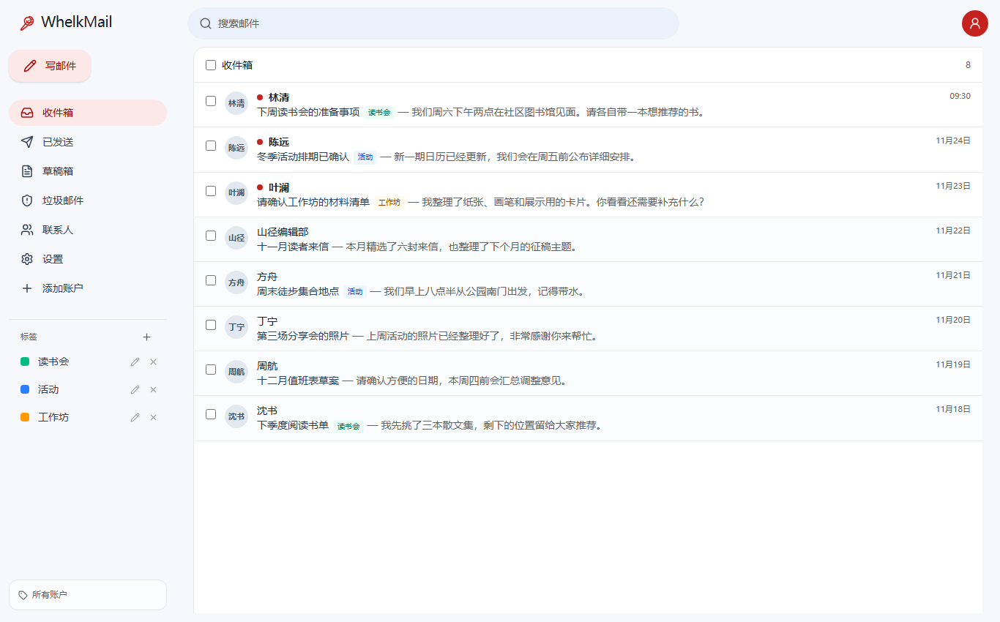
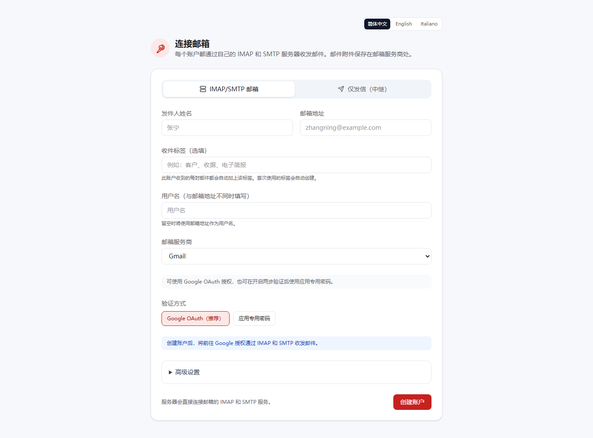

# WhelkMail

WhelkMail 是一款自托管网页邮箱客户端。把现有邮箱接入后，就可以在同一个收件箱中阅读和回复 Gmail、Outlook、iCloud、Fastmail、Yahoo 或自定义域名的邮件。应用通过 IMAP 收信，通过 SMTP 或发信中继发信。原有邮件、已发送副本、草稿和附件通常仍存放在邮箱服务商处；近期打开的正文会短暂缓存，需要长期保存时可单独开启归档。

这是 [WhelkMail 上游项目](https://github.com/WhelkMail/WhelkMail) 的简体中文版。首次使用默认显示简体中文，可在界面切换英文或意大利文。原作者为 mlzog，原项目与本分支均使用 MIT 许可证。[上游英文说明](https://github.com/WhelkMail/WhelkMail/blob/1bd0eefe224b29290f0aecbc7d9ffa033c14017a/README.md)

[](LICENSE)
[](https://workers.cloudflare.com)
[](https://pages.cloudflare.com)
[](#using-this-repository)

[](https://deploy.workers.cloudflare.com/?url=https://github.com/MingToneFurry/WhelkMail)

运行时可选 **Cloudflare Workers**（默认）、**Cloudflare Pages** 或 **VPS 上的 Docker**。你继续使用自己的邮箱服务商，无需自行维护邮件服务器。要体验上游版本的界面，可打开使用演示数据的[公开演示](https://demo.whelkmail.eu)。

[快速开始](#quick-start) · [部署到 Cloudflare](#deploy-on-cloudflare) · [用 Docker 部署](#deploy-on-docker) · [安全机制](#security) · [文档](#documentation)

<a id="screenshots"></a>

## 界面截图

以下截图使用虚构邮件，展示简体中文界面。



| 阅读邮件 | 写邮件 |
| --- | --- |
|  |  |

| 账户设置 | 添加邮箱 |
| --- | --- |
|  |  |

<a id="why-whelkmail"></a>

## 适用场景

- **统一收件箱**可以并排显示 Gmail、Outlook、iCloud、Yahoo 和域名邮箱，按颜色区分账户，并共用通讯录。
- **多种部署方式**共用同一套代码。在 Workers 或 Pages 上可配合 D1、R2 和 `cloudflare:sockets`；在 Docker 中，单个容器即可使用 SQLite，也可接入兼容 S3 的存储桶。
- **按需存储**。应用默认从服务商读取邮件，使用短期 D1 缓存加快近期邮件的打开速度。可选的 R2 或 Google 云端硬盘归档适合长期保存。
- **隐私保护**。HTML 邮件在沙箱内打开，默认屏蔽远程图片和跟踪像素，可按邮件单独放行。账户凭据加密保存。
- **自行托管**。项目以 MIT 许可证发布，无遥测。使用 Cloudflare 部署时只需自己的 Cloudflare 项目，使用 VPS 时可自行管理运行环境。

<a id="what-you-get"></a>

## 功能

<a id="inbox-experience"></a>

### 收件与阅读

- 邮件列表支持全宽阅读或右侧阅读窗格，可像 Gmail 一样多选后删除、移动或标记垃圾邮件。
- 提供收件箱、已发送、草稿和垃圾邮件文件夹；可自动保存草稿并重新打开编辑。
- 按账户将邮件分组成会话，优先使用 RFC 邮件头 `References`，缺失时按主题匹配。每个会话占一行，显示参与者和邮件数（例如 `Mario, Luca +2  5`）。在阅读窗格中点击各封邮件的标题，即可逐一展开，包括自己的回复。收件箱、已发送、垃圾邮件、标签和搜索结果均可按会话展示；草稿逐封列出。
- HTML 正文在沙箱中显示，远程图片按需载入。附件标记来自 IMAP `BODYSTRUCTURE`，无需预先下载正文。
- 富文本编辑器支持粗体、列表、链接和引用。每台设备分别保存默认使用富文本或纯文本的偏好，草稿保留 HTML 内容。
- 支持安装为渐进式网页应用（PWA）；手机使用抽屉式导航，Web Push 通知可按账户和文件夹配置。
- 支持简体中文、英文和意大利文，可以扩展翻译词典。

<a id="accounts-and-sending"></a>

### 账户与发信

- 同时显示多个邮箱；每个账户可使用独立的 IMAP、SMTP 服务器和凭据。
- 支持密码、应用专用密码、Google OAuth2 和 Microsoft OAuth2（XOAUTH2）。
- 普通邮箱通过各自服务商的 SMTP 服务器发信。
- 域名邮件先转发到其他邮箱时，回复可自动使用原收件地址。例如，发往 `EMAIL@DOMAIN.IT` 的邮件转发到 `EMAIL@PROVIDER.IT` 后，应用会根据收件人、抄送和转发头（`Delivered-To`、`X-Original-To`、`Envelope-To`、`Received … for`）匹配发件账户。也可在“设置 → 账户”中指定固定的回复身份。开启“允许使用此域名下的任意地址发信”的中继账户，可用邮件实际投递到的域名别名回复。
- 没有 SMTP 服务的域名可添加仅发信的中继账户，选择 SMTP2GO、Resend、Mailgun、Brevo、SendGrid、Mailjet、Postmark、Cloudflare Email Service 或自行填写主机、端口和凭据的 SMTP 服务器。每个中继账户可以选择一个位置保存已发送副本和草稿，包括 Google 云端硬盘、Cloudflare R2 或一个已连接的 IMAP 邮箱。自有域名可用一个中继账户回复多个别名。Cloudflare Email Service 尚属实验功能，参见[使用限制](#limitations)。
- IMAP 可选启用归档和服务商端清理：先保存正文与附件，再把原件移入服务商邮箱的垃圾箱。

<a id="organization"></a>

### 标签、通讯录与签名

- 所有账户共用一套标签。标签视图汇集收件箱、已发送、草稿和垃圾邮件中的相关邮件。
- 可为各账户的新来信自动添加指定标签。
- 通讯录支持搜索、编辑、CSV 导入导出，以及收件人、抄送和密送地址的自动补全。联系人可记录姓、名、电子邮箱、电话、公司、职位、地址、网站、生日、其他邮箱或电话及备注。vCard 导入时自动识别 3.0 和 4.0，导出默认 3.0，也可选 4.0。默认会把发信的收件人加入“其他联系人”以便补全，也可在“设置 → 常规”改为仅手动添加。输入陌生地址时可从补全菜单添加联系人；回复陌生发件人时自动添加。联系人存储在数据库中，无需 R2 或云端硬盘。
- 支持共享邮件签名或按账户分别设置签名，可使用富文本格式。
- 外出自动回复可对全部账户使用同一条消息，也可按账户单独设置，正文支持富文本。

<a id="automation"></a>

### 自动处理

- 所有账户共用筛选器。可按发件人、收件人、主题、关键词和附件匹配邮件，自动添加标签、转发原始 EML 邮件，或同时执行两项操作。
- IMAP 元数据分批增量同步到 D1。每个账户单独显示同步状态，中断后可以接着同步。
- 可启用后台定时任务，并为每个 IMAP 账户分别设置 1、2、5、10、15 或 30 分钟的检查间隔，默认 5 分钟。
- 同一定时任务也处理外出自动回复。每个发件人每 24 小时最多收到一次带自动回复标记的邮件。
- 转发邮件带有防循环邮件头。可按筛选器查看转发日志，另有删除操作日志。

<a id="security"></a>

## 安全机制

- 同一部署共用一个登录密码，可在“设置 → 安全”启用基于 TOTP 的双重验证（RFC 6238），兼容标准身份验证器。初始状态只启用密码，恢复码仅显示一次，数据库仅保存恢复码的哈希值。
- 部署密码至少 10 个字符，不能使用 `change-me` 或 `password` 等示例值。密码不符合要求时，Docker 容器拒绝启动；Workers 或 Pages 除 `/api/health` 外的请求均返回 `503`，直到修正密码。
- 服务端生成随机会话令牌，在 D1 中保存 SHA-256 哈希，有效期 7 天，退出登录时会撤销会话。
- 登录和双重验证按 IP 限速。
- IMAP/SMTP 密码、OAuth 刷新令牌和中继密钥使用 AES-256-GCM 加密保存，会话和挑战签名使用 HKDF 派生的密钥。
- Google、Microsoft 和云端硬盘的 OAuth 流程使用保存在 D1 中的一次性 state 和 PKCE（`S256`）。
- 静态资源和 API 响应设置 CSP、HSTS、`nosniff`、`X-Frame-Options`、`Referrer-Policy` 和 `Permissions-Policy`。
- HTML 邮件显示在具有严格 CSP 的沙箱 iframe 中，禁用脚本及表单。可在每封邮件中单独允许远程图片。

[技术说明](docs/DOCUMENTATION.md)记录完整的威胁模型。[Cloudflare 部署指南](docs/CLOUDFLARE.md)列出了部署检查项。

<a id="stack"></a>

## 技术栈

- React 19、Vite 8、TypeScript、Tailwind CSS。
- 与运行时无关的 API 核心位于 `server/`，通过三个轻量入口运行。
- Cloudflare Workers（默认）或 Pages Functions 均支持 D1 和 R2。
- Docker 使用 Node 24 和内置 SQLite 模块 `node:sqlite`。
- IMAP/SMTP 在 Cloudflare 上使用 `cloudflare:sockets`，在 Node 上使用 `node:net` 和 `node:tls`。
- 归档可选 R2、兼容 S3 的存储（包括 MinIO）或 Google 云端硬盘。
- 使用 `postal-mime` 解析 MIME 邮件。

<a id="quick-start"></a>

## 快速开始

本地开发需要 Node.js 24 或更高版本及 npm。Docker 镜像使用 Node.js 24。

**Cloudflare Workers（默认）**

```bash
npm install
# 创建 D1 数据库，并将数据库 ID 写入本地 wrangler.jsonc
npx wrangler d1 create mail-client --binding DB --update-config
npm run db:init:workers:remote
npx wrangler secret put APP_PASSWORD
npx wrangler secret put TOKEN_ENC_KEY
npm run deploy
```

一键部署会根据绑定自动创建 D1 数据库，将 ID 写入新仓库，并提示你填写 `APP_PASSWORD` 和 `TOKEN_ENC_KEY`。OAuth、发信中继及 Web Push 的 VAPID 参数都是可选项，可以稍后参考 `.dev.vars.example` 配置。Workers 的定时任务直接在 Worker 内运行，可以省略 `CRON_SECRET`。CI 会通过 `WRANGLER_CI_OVERRIDE_NAME` 把自定义名称传给 `wrangler deploy`；在本地可以运行 `WORKER_NAME=my-worker npm run deploy` 指定名称。

**Cloudflare Pages**

```bash
npm install
npm run db:init:local
npm run dev:pages
```

Pages 本地开发使用仓库里的 `wrangler.jsonc` 配置绑定。如有旧版 `wrangler.toml`，请先移除。Pages 要求使用标准配置路径，线上绑定以 Cloudflare 控制台为准。

**Docker**

```bash
cd deploy/docker
cp .env.example .env
# 在 .env 中设置 APP_PASSWORD、TOKEN_ENC_KEY 和 PUBLIC_ORIGIN
docker compose up -d --build
```

三种部署方式都需要设置网站登录密码 `APP_PASSWORD` 和凭据加密密钥 `TOKEN_ENC_KEY`。可以用以下命令生成密钥：

```bash
node -e "console.log(require('crypto').randomBytes(32).toString('base64'))"
```

在本地开发 Cloudflare 版本时，把这两个值写入仓库根目录的 `.dev.vars`。Git 会忽略这个文件。

本地开发命令：

```bash
npm install
npm run dev            # Vite 开发服务器：http://localhost:5173
npm run dev:workers    # Worker 和本地 D1：http://localhost:8787
npm run dev:pages      # Pages Functions：http://localhost:8788
```

各部署方式的密钥、数据库迁移、S3、定时任务及反向代理配置，见[部署指南](docs/DEPLOYMENT.md)。

<a id="using-this-repository"></a>

## 使用本仓库

自托管需要使用自己的数据库和密钥。

- 点击 GitHub 的 **Use this template**（使用此模板）或 **Fork**，创建自己的仓库。
- 自建 D1 数据库并执行数据库迁移。
- 在 Cloudflare 控制台设置自己的密钥。
- 仓库内的 `wrangler.jsonc` 预留了 `database_id`。一键部署会在创建 D1 后把 ID 写入新仓库；通过 CLI 部署时可以把 ID 写入本地配置，提交前排除此项改动。Git 也会忽略旧版 `wrangler.toml`。

<a id="deploy-on-cloudflare"></a>

## 部署到 Cloudflare

[](https://deploy.workers.cloudflare.com/?url=https://github.com/MingToneFurry/WhelkMail)

上面的按钮会部署本仓库的中文版 Worker，并提示绑定 D1、填写必要密钥。上游英文版本也提供[一键部署入口](https://deploy.workers.cloudflare.com/?url=https://github.com/WhelkMail/WhelkMail)。Pages 的手动部署步骤、控制台操作、绑定、密钥、OAuth 应用设置及常见故障排查，见 [Cloudflare 部署与使用指南](docs/CLOUDFLARE.md)。

**Cloudflare Workers（默认）**

```bash
npx wrangler d1 create mail-client --binding DB --update-config
npm run db:init:workers:remote
npx wrangler secret put APP_PASSWORD
npx wrangler secret put TOKEN_ENC_KEY
npm run deploy
```

使用一键部署时可跳过第一条命令。Cloudflare 会创建 D1，把数据库 ID 写入新仓库，然后提示设置密钥。CI 使用 `WRANGLER_CI_OVERRIDE_NAME` 传入 Worker 名称，本地 CLI 使用 `WORKER_NAME`。

Workers Assets 提供前端静态资源，`/api/*` 请求由 Worker 处理。Worker 的 `[triggers] crons` 配置负责后台同步、通知、过滤器和休假自动回复，无需额外部署调度服务。

**Cloudflare Pages**

已有项目可以直接部署新版本，继续使用现有的 D1、R2 绑定和密钥。新建 Pages 项目时：

1. 通过本地 CLI 执行 `npx wrangler d1 create mail-client --binding DB --update-config` 创建数据库，或在 Pages 控制台设置 `DB` 绑定。移除本地旧版 `wrangler.toml`。
2. 在 Pages 中从 GitHub 仓库创建项目。构建命令填 `npm run build`，输出目录填 `dist`，环境变量填 `NODE_VERSION=22`。
3. 添加名为 `DB` 的 D1 绑定，并设置 `APP_PASSWORD`、`TOKEN_ENC_KEY` 两个密钥。
4. 新数据库执行 `npm run db:init:remote`；已有数据库执行 `npm run db:migrate:remote`。
5. 如需 Web Push，执行 `npm run vapid`，添加 VAPID 密钥和 `CRON_SECRET`，再执行 `cp worker/wrangler.toml.example worker/wrangler.toml`，设置 `APP_URL` 后执行 `npm run cron:deploy`。
6. 执行 `npm run deploy:pages`，打开部署得到的 Pages 网址。

IMAP/SMTP 的 TLS 握手可能超出免费套餐的 CPU 配额，长期运行建议选择 Workers Paid 套餐。

<a id="deploy-on-docker"></a>

## 使用 Docker 部署

```bash
cd deploy/docker
cp .env.example .env
# 在 .env 中设置 APP_PASSWORD、TOKEN_ENC_KEY 和 PUBLIC_ORIGIN
docker compose up -d --build
```

使用 Caddy、Traefik 或 nginx 提供 HTTPS 反向代理，并将 `PUBLIC_ORIGIN` 设成公开访问的网址。SQLite 数据库存放在挂载到 `/data` 的 `whelkmail-data` 数据卷中，容器启动时会执行数据库迁移。容器自带邮件同步和通知调度器。如需使用 S3/MinIO 存储，请在 `.env` 中设置 `S3_*` 变量，再执行 `docker compose --profile s3 up -d --build`。备份、S3 配置和更新方法见[部署指南](docs/DEPLOYMENT.md)。

<a id="configuration"></a>

## 配置

每个 IMAP/SMTP 账户分别保存自己的服务器地址和凭据。下面的部署参数可以按需设置。

| 变量 | 用途 |
| --- | --- |
| `GOOGLE_CLIENT_ID` / `GOOGLE_CLIENT_SECRET` | 为发信中继和 IMAP 账户启用 Google 云端硬盘归档 |
| `GOOGLE_MAIL_CLIENT_ID` / `GOOGLE_MAIL_CLIENT_SECRET` | 通过 Google OAuth 授权 IMAP/SMTP 收发信 |
| `MICROSOFT_CLIENT_ID` / `MICROSOFT_CLIENT_SECRET` / `MICROSOFT_TENANT` | 为 Outlook 或 Microsoft 365 设置 OAuth |
| `RELAY_PROVIDER` / `RELAY_API_KEY` / `RELAY_API_SECRET` | 为当前部署设置默认发信中继 |
| `MAILGUN_DOMAIN` / `MAILGUN_REGION` | 使用 Mailgun 作为默认中继时的域名和区域 |
| `BUCKET`（R2 绑定） | 启用可选的 R2 归档 |
| `UPDATE_CHECK` | 设为 `off` 可停止向 GitHub 查询新版本，详见[升级指南](docs/UPGRADE.md) |
| `GITHUB_TOKEN` | 可选令牌，用于提高版本查询的请求配额 |

也可以在网页上为单个账户填写中继凭据。凭据会加密保存。

<a id="documentation"></a>

## 文档

- [上游在线演示](https://demo.whelkmail.eu)：使用模拟数据和模拟 API 的静态预览。
- [部署指南](docs/DEPLOYMENT.md)：对照查看 Workers、Pages 和 Docker 的部署流程。
- [Cloudflare 部署与使用指南](docs/CLOUDFLARE.md)：Cloudflare 平台的详细设置。
- [技术文档](docs/DOCUMENTATION.md)：系统架构、安全、邮箱行为及限制。
- [开发指南](docs/DEVELOPMENT.md)：本地开发流程、数据库迁移、测试及发布到公开仓库。
- [升级指南](docs/UPGRADE.md)：更新现有部署，以及如何使用应用内的版本通知。

<a id="limitations"></a>

## 使用限制

- **收信与同步。** WhelkMail 通过定时同步获取新邮件和标记，未实现 IMAP IDLE。文件夹列表读取 D1 中的本地副本。同步期间，客户端逐渐延长状态查询间隔，当出现新的 UID、历史邮件载入进度或文件夹状态发生变化时刷新列表；同步结束后再刷新一次。你可以在设置中手动同步，或为每个账户启用自动同步。在“设置 → 账户”中可以调整查收间隔，默认为 5 分钟。通知、过滤器和清理任务每分钟运行一次。
- **推送通知。** Web Push 需要 VAPID 密钥和定时任务。Workers 使用 cron 触发器，Pages 单独部署 `worker/`，Docker 使用内置的 Node 调度器。Pages 的定时任务从外部调用 `POST /api/cron/notifications`，需要配置 `CRON_SECRET`。Workers 在同一进程中执行任务；Docker 在未配置该变量时自动生成本地密钥。
- **HTML 邮件。** 正文在沙箱内显示，默认屏蔽远程图片，可逐封允许加载。链接在新标签页中打开，脚本和表单均已禁用。
- **首次加载与搜索。** 首次打开账户时从服务商获取最近的邮件，之后从 D1 读取列表。每次同步根据 `UIDNEXT` 获取新增邮件，再分批补齐历史记录。搜索覆盖收件箱、已发送、草稿、垃圾邮件和联系人，也可限定文件夹。搜索采用忽略大小写的子串匹配（`LIKE`），不支持词干提取和模糊匹配。每次同步会为少量 IMAP 正文建立索引，打开邮件时也会建立索引。尚未索引正文的邮件仍可通过发件人、收件人或主题找到。
- **分页。** 邮件列表和搜索结果通过游标分页，点列表底部的“加载更多邮件”可继续查看，数量可以超过 100 封。
- **文件夹和操作。** 界面提供收件箱、已发送、草稿和垃圾邮件。可以批量选择、删除邮件，或将其移到收件箱、垃圾邮件、已删除邮件；阅读时也可以直接标记为垃圾邮件。
- **正文缓存。** D1 最长缓存最近阅读或列出的邮件正文 3 天，每封最多 512 KB。较大邮件及附件按需向服务商读取，配置了长期归档时也可从归档读取。通过 `cid:` 引用的内嵌图片会随邮件详情一并返回。
- **标签视图。** 优先从 D1 的本地副本读取邮件；本地数据不可用时，根据打过标签的 UID 向服务商获取。
- **元数据保留时间。** IMAP 元数据默认长期保留。可在“设置 → 外观”中设定期限；清理时会移除 D1 中已过期邮件的元数据及其标签，草稿、服务商中的原件和 R2/Drive 归档仍予保留。清理过的邮件会从列表、搜索结果和标签视图中消失，增量同步也会跳过它们。通过邮件直达链接仍可按需向服务商获取正文。“设置 → 外观”显示上次清理的时间和数量。点“重新下载元数据”会重置同步游标，后台重新获取邮件列表；此前清理的标签需要重新添加。
- **过滤规则。** 打开收件箱或同步到新邮件时会运行过滤器。可匹配发件人、收件人、主题和正文摘要。正文建立索引后会重新检查关键词，避免只收到邮件头时就用空摘要判断。“收件人”还会匹配转发前的地址（来自 `Delivered-To`、`X-Original-To` 或 `Received … for`）。例如 `info@domain` 转发到 `you@provider` 时，可以直接按 `info@domain` 筛选。
- **处理已有邮件。** 自动转发和服务商清理使用与 Web Push 相同的调度器，默认处理首次同步之后收到的新邮件。要处理邮箱中已有的邮件，可点单条过滤规则的标签按钮，或在“设置 → 过滤器”中对所有已启用的规则执行“应用所有过滤器”。后一种方式可以选择转发符合条件的旧邮件；对每条规则，每封邮件只转发一次。
- **回复身份。** 新建邮件时从已配置的账户选择发件人。回复时会选原邮件的收件账户，也可在“设置 → 账户”中为单个邮箱指定回复身份。中继账户启用“允许从该域的任意地址发信”后，可使用原收件别名（例如 `shop@DOMAIN.IT`）回复。转发标头本身不受签名保护，所以只有收件服务器最上方的 `Authentication-Results` 记录了该域通过 DKIM 验证时，程序才采信其中的别名。缺少可信验证结果，或带有效签名的邮件被添加转发标头后重新投递，都可能导致身份判断失准。别名必须与中继账户的域名完全相同。发送前可在“发件人”栏核对地址；同一个域名若配置了两个允许使用任意别名的中继账户，系统会因身份有歧义而不提供别名。
- **归档切换。** IMAP 正文归档可在 R2 和 Google Drive 之间切换。每条记录都保存其实际写入位置，旧记录会依次尝试两个后端，因此此前归档的邮件仍可阅读。
- **中继发信。** 中继账户必须配置**已发送副本的存储位置**，可选 Google Drive、R2 或另一个 IMAP 邮箱。使用 Drive 或 R2 时，系统先保存副本，写入失败会在调用中继前返回 `storage_failed`。使用 IMAP 时，中继接受邮件后才将副本写入“已发送”。如果这一步失败，界面会显示警告，邮件可能已经发出。
- **IMAP 中的中继副本与草稿。** `storage_driver = 'imap'` 依赖所选邮箱的连接。连接断开期间，需重新连接或改用 Drive/R2 才能保存新草稿。如果 IMAP 的 `APPEND` 写入失败，系统会尝试将完整邮件（含附件和 `.eml`）保存到可用的 Drive 或 R2；已发送邮件如无可用的对象存储，则只能从数据库中读取正文。副本和草稿也真实存在于所选邮箱中，列表与搜索会合并显示，每封邮件只在中继账户下列出一次。删除中继记录会同时删除邮箱中的实际副本；移动已发送记录会将邮件移到目标文件夹，随后由目标账户的本地副本跟踪。
- **账户访问。** 整个部署共用一个 `APP_PASSWORD`，可启用 TOTP 双因素认证。此访问模型适用于个人或小型团队，不提供多租户隔离。
- **登录保护。** 登录尝试按 IP 限速。需要统一身份或网络边界防护时，可配合 Cloudflare Access 或 Web 应用防火墙。
- **移除账户。** 删除账户会清理其 D1 记录，并按各条记录实际使用的存储后端，尝试删除对应的 R2/Drive 对象，包括更换存储位置前写入的对象。服务商邮箱中的邮件仍保留。若因 Drive 令牌被撤销等原因无法清理，残留对象会列在“设置 → 系统”中；账户凭据已删除，应用无法再次尝试。删除为中继账户保存已发送副本的邮箱需要二次确认：邮件仍留在服务商处，但无法再从应用打开这些副本的附件和 `.eml`。
- **连接诊断。** 已登录的管理员可以查看服务商返回的详细错误，便于排查 IMAP 和 SMTP 配置。
- **版本提醒。** 应用通过比较已安装版本和 GitHub 最新发布版本提示更新。Worker 会将查询结果缓存一天，此请求不携带用户数据。需要更新时由管理员部署新版本；设置 `UPDATE_CHECK=off` 可以关闭检查。
- **Cloudflare Email Service 为实验功能。** 上游维护者尚未用真实 Cloudflare 账户验证投递、发送抑制（错误 `10205`）、限速和逐个收件人的失败回报。需要经过实际使用验证的发送方式时，可选择 SMTP2GO 等已有中继。
- **Workers 免费额度。** IMAP/SMTP 的 TLS 握手可能超过免费套餐的 CPU 配额，上游建议使用付费 Workers。调度器默认每分钟唤醒，以便执行各账户的查收间隔；即使没有到期任务，这些唤醒也会占用每日免费请求配额的约 3%。设置 1～2 分钟的高频查收会频繁建立 IMAP 连接，更适合付费套餐。使用免费版时，可在 `wrangler.jsonc`（Pages 使用 `worker/wrangler.toml`）中设定 `crons = ["*/5 * * * *"]`，将唤醒频率降为原来的五分之一。Docker 部署不受上述 Workers CPU 配额限制。
- **Google OAuth。** WhelkMail 使用受限权限 `https://mail.google.com/`。面向公众的生产应用需按 Google 的流程完成验证，可能涉及 CASA 安全评估。个人应用可在测试模式中把自己的邮箱列为测试用户，刷新令牌有效期为 7 天。支持应用专用密码的 Google 账户也可用该方式连接。

<a id="license"></a>

## 许可证

本项目采用 [MIT 许可证](LICENSE)。
